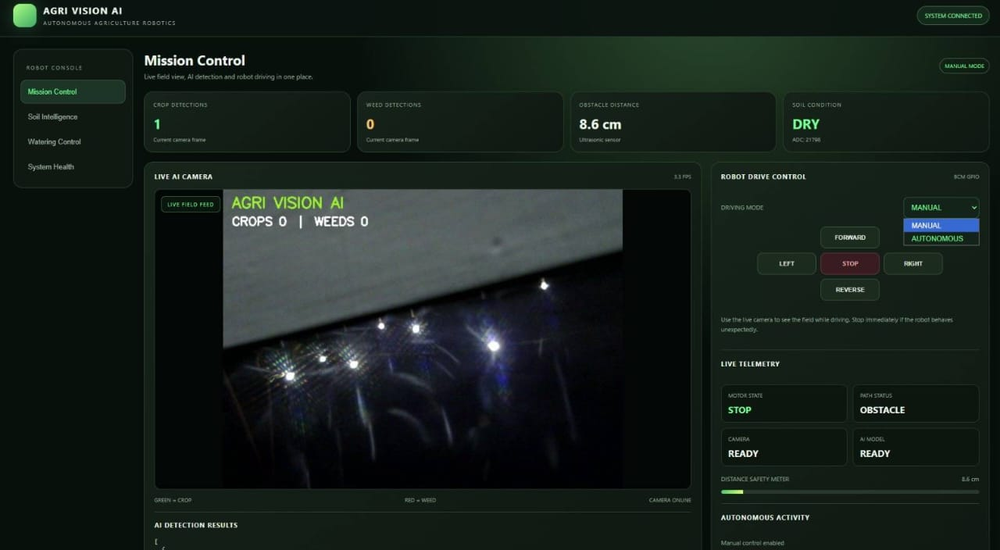
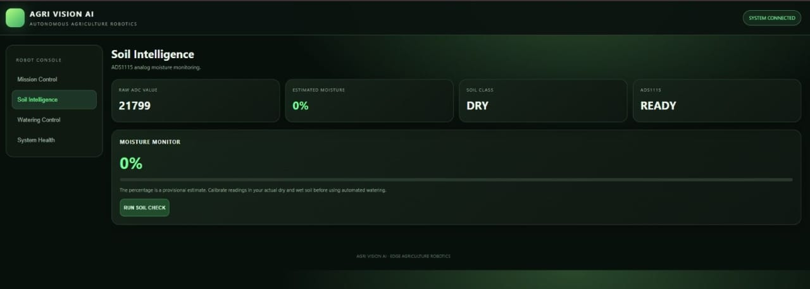
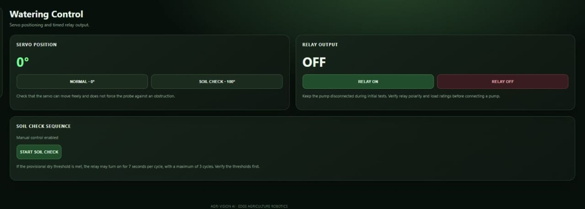

# Crop vs. Weed Detection Model (YOLO)

**AI-Based Autonomous Plant Identification, Weed Detection and Precision Spraying Robot using YOLO and Raspberry Pi**

This repository holds the vision model, on-robot software and dashboard of the project above.

## Academic Details

| | |
| :--- | :--- |
| **Mentor** | Dr. A. Baskar |
| **Course** | 23CSE472 – Artificial Intelligence and Robotics |
| **Department** | Department of Computer Science and Engineering |
| **Institution** | School of Computing, Amrita Vishwa Vidyapeetham, Coimbatore, India |

### Team Members

| No. | Name | Roll No. |
| :-: | :--- | :--- |
| 1 | Manvitha Dungi | CB.SC.U4CSE23318 |
| 2 | Kanishka S | CB.SC.U4CSE23328 |
| 3 | Leela M | CB.SC.U4CSE23336 |
| 4 | Jaswita Manduva | CB.SC.U4CSE23430 |
| 5 | Bharath | CB.SC.U4CSE23609 |
| 6 | Pranav | CB.SC.U4CSE23611 |

## Project Overview

Small and medium farms usually spray fertilizer and weedicide uniformly across a whole field. This wastes chemicals, raises input costs and harms the environment. This project builds a low-cost 4WD ground robot that drives along a row of plants, uses a camera to tell **crops** from **weeds**, and sprays only what it detects: **fertilizer on crops, weedicide on weeds**.

This folder holds the machine-learning part of that system: the lightweight YOLO object detector that runs on the robot's Raspberry Pi 4.

## Demo Video

Short demonstration of the robot running together with the live dashboard:

[Watch the demo (docs/demo.mp4)](docs/demo.mp4)

<video src="docs/demo.mp4" controls width="720"></video>

If the player does not appear in your viewer, open the link above or download the file.

## Role of the Model

| Item | Detail |
| :--- | :--- |
| Task | Object detection with two classes: `crop` and `weed` |
| Input | Live USB webcam frames (about 640 px wide) |
| Output | Bounding boxes, class labels and confidences per frame |
| Target hardware | Raspberry Pi 4, CPU only (no GPU) |
| Target speed | About 5–10 FPS |
| Framework | Ultralytics YOLO (YOLOv5 / YOLOv8 nano or tiny variant) |
| Training | Offline on a separate GPU machine; trained weights are copied to the Pi |

## Why YOLO

Several object detection models were compared on the weed dataset. YOLO gave the best balance of accuracy and computational cost. RF-DETR Nano scored slightly higher in accuracy, but YOLO needs far less storage, RAM and VRAM, which suits the Raspberry Pi-based robot.

## How the Detections Are Used

For each detection, the bounding-box centre `(u, v)` is used downstream:

1. **Target localization (pinhole camera model).** With camera height `h_c`, pitch `α`, focal lengths `f_x, f_y` and optical centre `(c_x, c_y)`:
   - `x_c = (u − c_x) / f_x`, `y_c = (v − c_y) / f_y`
   - `x_p = h_c / tan(α + arctan(y_c))`, `y_p = x_p · x_c`
2. **Nozzle steering.** `θ_s = clamp(arctan(y_p / d_s), −45°, +45°)` drives the MG996R servo.
3. **Spray timing.** `Δt_act = D_sep / v − Δt_sys`, where `Δt_sys` is the sum of vision, communication, relay and fluid delays.
4. **Spray action.** The class label picks the liquid (`crop` → fertilizer, `weed` → weedicide). The relay switches the pump, and spray duration grows with bounding-box area.

The full derivation is in Section 2 of the review document.

## Simplified Control Loop

```python
import cv2
from ultralytics import YOLO
from gpiozero import AngularServo, OutputDevice

model = YOLO("crop_weed_yolo.pt")          # trained lightweight YOLO weights
servo = AngularServo(18, min_angle=0, max_angle=180)
pump_relay = OutputDevice(23, active_high=True, initial_value=False)

CAMERA_FOV_DEG = 60
FRAME_WIDTH = 640

def bbox_to_servo_angle(x_center_px):
    offset_ratio = (x_center_px - FRAME_WIDTH / 2) / (FRAME_WIDTH / 2)
    return 90 + offset_ratio * (CAMERA_FOV_DEG / 2)   # 90 deg = nozzle centred

def spray_duration_for(box_area_px):
    return min(0.3 + box_area_px / 50000.0, 1.5)      # seconds, capped

cap = cv2.VideoCapture(0)
while True:
    ok, frame = cap.read()
    if not ok:
        continue
    for box in model(frame, verbose=False)[0].boxes:
        label = model.names[int(box.cls[0])]           # "crop" or "weed"
        x1, y1, x2, y2 = box.xyxy[0]
        servo.angle = bbox_to_servo_angle((x1 + x2) / 2)
        pump_relay.on()
        cv2.waitKey(int(spray_duration_for((x2 - x1) * (y2 - y1)) * 1000))
        pump_relay.off()
```

This is the simplified listing from the review document. The `label` is not yet used to choose between the fertilizer and weedicide lines. That selection is part of the integration work still to do.

## Robot Dashboard (Agri Vision AI)

`rasp.py` is the on-robot Flask application that runs on the Raspberry Pi. It runs the ONNX crop/weed detector through OpenCV's DNN module (`best.onnx`, 416 px input, confidence 0.35, NMS 0.45), streams the annotated camera feed, drives the motors, reads the sensors and serves a single-file web dashboard.

### Mission Control

Live AI camera feed with crop and weed counts, ultrasonic obstacle distance, soil condition, manual/autonomous driving mode, drive buttons and live telemetry (motor state, path status, camera and model readiness).



### Soil Intelligence

Raw ADS1115 reading from the capacitive soil sensor, a provisional moisture percentage, a DRY / MOIST / WET class and a "Run soil check" action.



### Watering Control

Manual servo positioning (normal and soil-check positions), manual relay on/off and a timed soil-check sequence.



### Behaviour and safety rules in the code

| Item | Behaviour |
| :--- | :--- |
| Obstacle guard | Any movement command is blocked when the ultrasonic distance is under 20 cm |
| Autonomous mode | Prototype logic only: drive forward while a crop is detected, stop when there is no crop or an obstacle |
| Soil check | Moves the probe servo, reads the soil sensor, and if the reading is dry runs the pump relay for 7 s per cycle, at most 3 cycles. The relay is always switched off at the end |
| Soil calibration | `SOIL_DRY_ADC = 18000` and `SOIL_WET_ADC = 12000` are provisional. Calibrate in real dry and wet soil before relying on automatic watering |
| Pump | Keep it disconnected during initial tests and verify relay polarity (`RELAY_ACTIVE_HIGH`) first |

### BCM pin map (from `rasp.py`)

| Function | BCM pin |
| :--- | :-: |
| Motor driver IN1 / IN2 / IN3 / IN4 | 23 / 24 / 27 / 22 |
| Ultrasonic TRIG / ECHO | 5 / 6 |
| Pump relay | 17 |
| Servo | 12 |
| Soil sensor | ADS1115 on I2C, channel A0 |

The soil-check probe position is set by `SOIL_CHECK_ANGLE` (100 degrees, matching the dashboard button) near the top of `rasp.py`.

## How to Run

### A. Run the robot on the Raspberry Pi

1. **Prepare the Pi.** Use Raspberry Pi OS with Python 3 and enable I2C (`sudo raspi-config` > Interface Options > I2C). Connect the hardware using the BCM pin map in the dashboard section above.
2. **Install dependencies.**
   ```bash
   sudo apt update && sudo apt install -y python3-opencv python3-numpy python3-flask python3-rpi.gpio python3-lgpio python3-gpiozero
   pip install adafruit-circuitpython-ads1x15
   ```
   If you use a virtual environment, create it with `--system-site-packages` so the apt packages are visible.
3. **Copy the model.** Put the exported detector at `~/CropWeedAI/models/best.onnx` (the path is `MODEL_PATH` in `rasp.py`). Export it from your trained weights at the size the code expects:
   ```bash
   yolo export model=best.pt format=onnx imgsz=416
   ```
   The code expects a 2-class output of shape 6 x 3549 (4 box values + `crop`, `weed`).
4. **Plug in the USB webcam** (`CAMERA_INDEX = 0`) and check the relay polarity (`RELAY_ACTIVE_HIGH`). Keep the pump disconnected for the first run.
5. **Start the app.**
   ```bash
   python3 rasp.py
   ```
6. **Open the dashboard** from a phone or laptop on the same Wi-Fi: `http://<pi-ip-address>:5000` (find the address with `hostname -I`).
7. **Check System Health.** Camera, AI model, GPIO and ADS1115 should all read READY. Any problem is shown under "Last error".
8. **Drive in Manual mode first.** Test STOP, then the drive buttons, then hold an object in front of the ultrasonic sensor (under 20 cm) and confirm movement is blocked.
9. **Calibrate the soil sensor.** Note the ADC value in dry and in wet soil and update `SOIL_DRY_ADC` and `SOIL_WET_ADC` in `rasp.py`. Only then try **Run soil check** with the pump connected.
10. **Try Autonomous mode** last. In this prototype the robot drives forward only while a crop is detected and stops otherwise or when an obstacle is near.

Press `Ctrl+C` to stop. The motors are stopped and the relay is switched off on exit.

### B. Train the detector

1. Open `YOLOv8_plant_detection.ipynb` in Google Colab (GPU runtime) and mount Google Drive.
2. Put your YOLO-format dataset (`data.yaml` with `crop` and `weed`) under `MyDrive/YOLO/data`. To fetch the Roboflow dataset locally instead, set `ROBOFLOW_API_KEY` in a `.env` file and run `python download_roboflow.py`.
3. Run the notebook cells. Training runs `yolo task=detect mode=train model=yolov8l.pt data=data.yaml epochs=50 imgsz=224`, then validates and predicts on test images.
4. Download `runs/detect/train2/weights/best.pt` and export it to ONNX as in step A3.

### C. Benchmark on a computer or the Pi

```bash
pip install -r requirements.txt
python 05_export_benchmark.py --weights best.pt            # export + benchmark here
python 05_export_benchmark.py --no-export --model best.onnx   # on the Pi, benchmark an exported model
```

This script reads `config.py` and expects the prepared dataset test images (`datasets/crop_weed/images/test`) or a folder given with `--images`.

### D. Other demos

- **Plant-disease web demo:** `pip install streamlit gdown imageio pillow ultralytics`, add `GDRIVE_FILE_ID = "<id of best.pt on Google Drive>"` to `.streamlit/secrets.toml`, then `streamlit run app.py`.
- **Video tracking:** place `best.pt` and `apple.mp4` next to `track.py` and run `python track.py` (press `q` to quit).
- **MATLAB humanoid case study:** open `OP2_Robot_Casestudy` in MATLAB and run `main_robocup.m` (see its README).

## Setup

```bash
pip install -r requirements.txt
# Dashboard on the Pi also needs Flask; the disease demo (app.py) needs streamlit, gdown, imageio, pillow
# On the Raspberry Pi, also:
pip install gpiozero RPi.GPIO adafruit-circuitpython-ads1x15
```

### Training (GPU machine)

```bash
yolo detect train data=crop_weed.yaml model=yolov8n.pt imgsz=640 epochs=100
```

The command above is a starting template. `crop_weed.yaml` (dataset paths and the `crop` / `weed` class names) still needs to be created, and the epochs and image size should be tuned to the dataset. Copy the resulting `best.pt` to the Pi as `crop_weed_yolo.pt`.

### Inference (Raspberry Pi)

```bash
yolo detect predict model=crop_weed_yolo.pt source=0
```

## Repository Contents

| Path | Purpose |
| :--- | :--- |
| `rasp.py` | On-robot Flask app: camera, ONNX inference, motors, ultrasonic, soil sensor, servo, relay, dashboard |
| `YOLOv8_plant_detection.ipynb` | Colab notebook: trains YOLOv8l (50 epochs, imgsz 224), validates and predicts on test images |
| `config.py` | Shared paths and defaults (classes `crop` / `weed`, 70/20/10 split, image size 320, seed 42) |
| `download_roboflow.py` | Downloads the Roboflow crop/weed dataset in YOLOv8 format. Needs `ROBOFLOW_API_KEY` in `.env` or the environment |
| `05_export_benchmark.py` | Exports `best.pt` to ONNX / NCNN and benchmarks ms per image and FPS. Re-run it on the Pi for real numbers |
| `app.py` | Separate Streamlit demo: plant-disease detection (10 classes such as Apple Scab and Tomato Leaf Mold) on uploaded images or videos. Weights are fetched from Google Drive using `st.secrets["GDRIVE_FILE_ID"]` |
| `track.py` | Runs YOLO tracking on a local video (`apple.mp4`) with an OpenCV preview window |
| `OP2_Robot_Casestudy/` | Separate MATLAB case study: ROBOTIS OP2 humanoid balance in a RoboCup match (see its own README) |
| `docs/images/` | Dashboard screenshots used in this README |

## Status

| Item | Status |
| :--- | :--- |
| Model comparison on the weed dataset | Done: YOLO selected (see above) |
| YOLO crop/weed training | In progress |
| Drive, sensing and spraying subsystems | Bench-tested individually |
| Web dashboard (drive, soil, watering) | Working on the robot (see screenshots above) |
| Full detect-aim-spray loop on the robot | Under integration and testing |

No final accuracy or FPS figures are recorded yet.

## Future Work

- Finish training and validation on a larger, more varied labelled dataset.
- Tune the bearing-to-servo mapping and spray-duration function with real bench-test data.
- Test under different lighting and plant-spacing conditions.
- Compare YOLO against other lightweight detectors (e.g. MobileNet-SSD) on the Pi 4.
- Consider a Coral USB Accelerator / Edge TPU or Raspberry Pi AI Camera if the frame rate is too low.
- Measure the chemical savings against a blanket-spraying baseline.

## Hardware Used

Raspberry Pi 4, USB webcam, 4WD chassis with L298N driver, MG996R servo (nozzle pan), 12 V mini pump with 5 V relay, HC-SR04 ultrasonic sensor, capacitive soil-moisture sensor via ADS1115, 12 V battery with LM2596 buck converter.

## References

1. J. Redmon, S. Divvala, R. Girshick, A. Farhadi, "You Only Look Once: Unified, Real-Time Object Detection," CVPR, 2016.
2. R. Siegwart, I. R. Nourbakhsh, D. Scaramuzza, *Introduction to Autonomous Mobile Robots*, 2nd ed., MIT Press, 2011.
3. A. Wang, W. Zhang, X. Wei, "A review on weed detection using ground-based machine vision and image processing techniques," *Computers and Electronics in Agriculture*, vol. 158, pp. 226–240, 2019.
